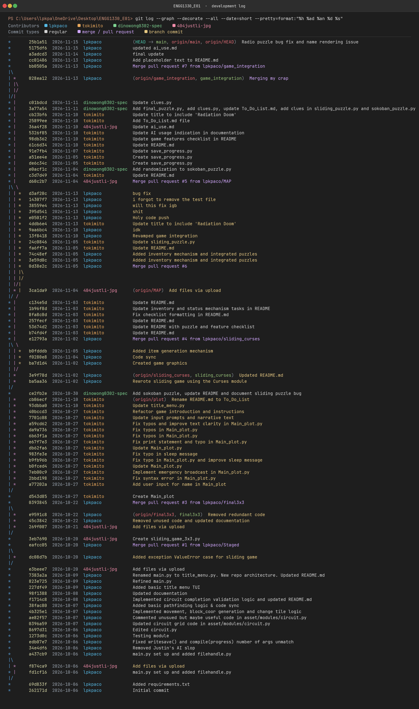
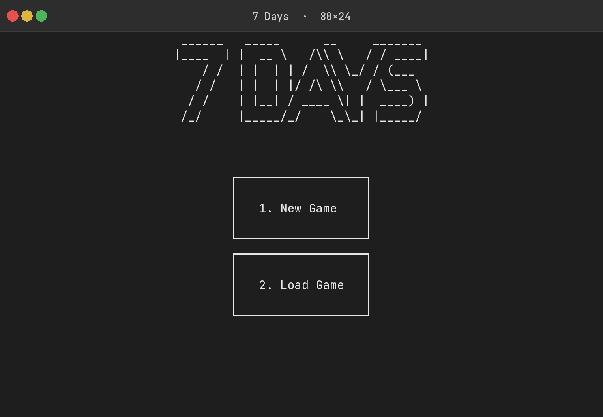
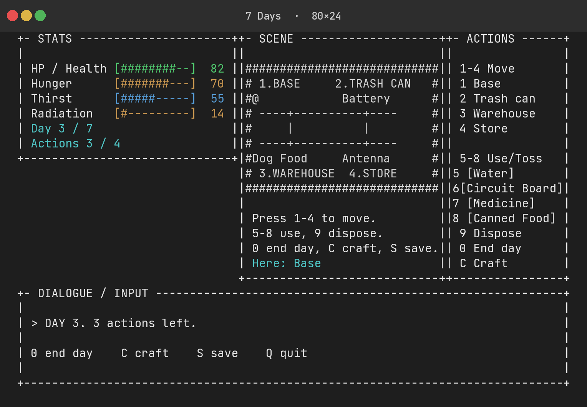
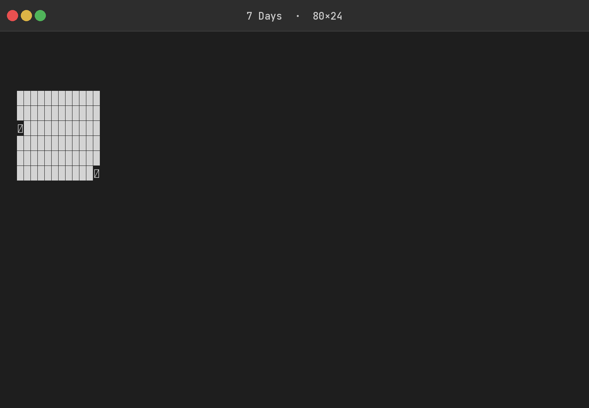
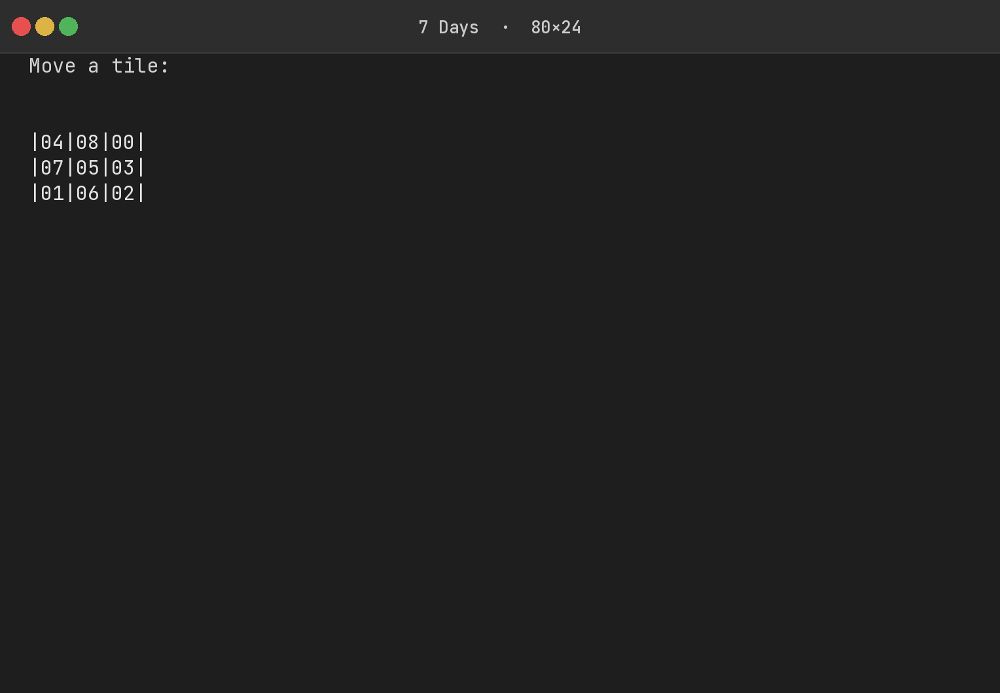
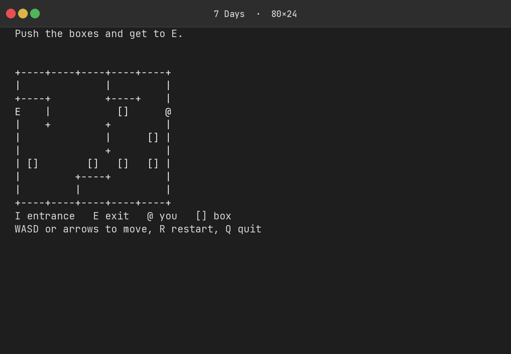
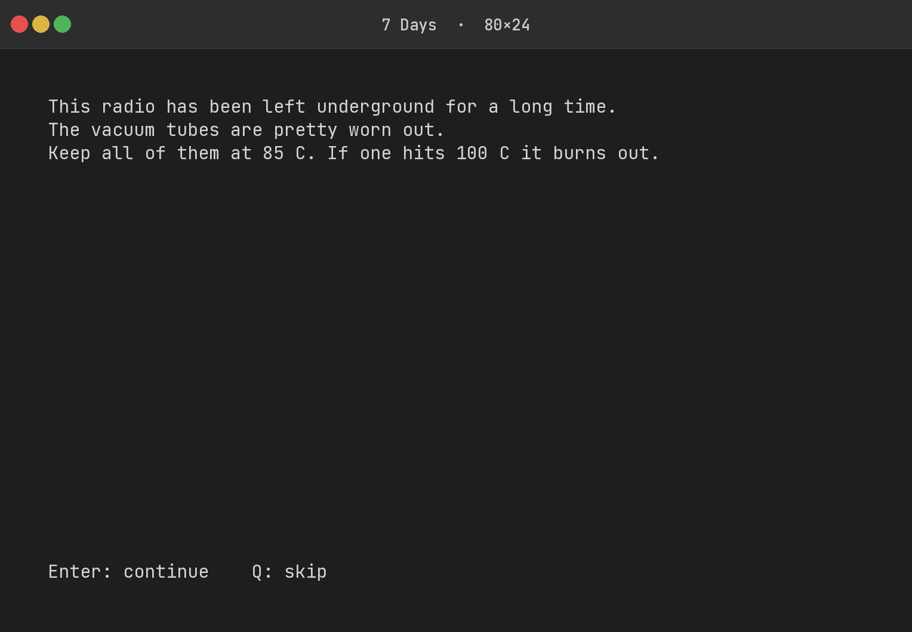
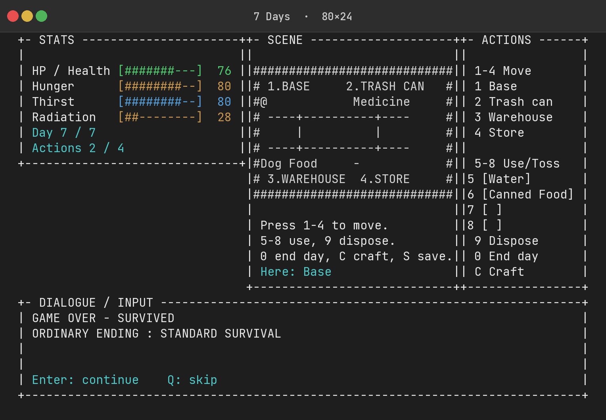
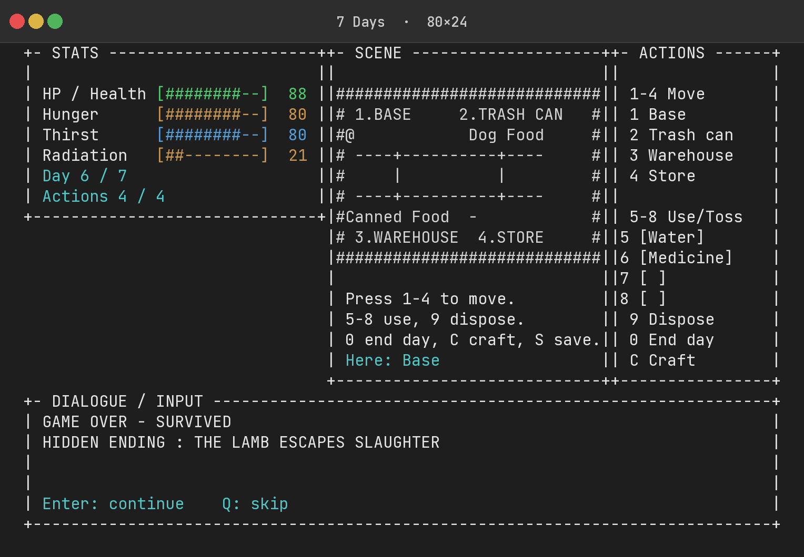

# 7 Days

ENGG1330 Group Project, Group E01

In 7 Days, you play as someone who just locked themselves in a shelter after a nuclear war broadcast. The government says rescue comes in seven days, so you have to stay alive until then. Food, water, medicine and radio parts are spread around four places on the map, and some of them are locked behind puzzles.

If you just survive until day 7, a “rescue” team shows up and takes you away. If you find some special items and use them properly, you can unlock the hidden ending.

## Name

Liu Peikun

Li Zi Chen

Leung Ka Lun Kimi

Wang Yung Yung  (Applied for leave of absence and quitted in the later stage of the project)

## Development log
Check https://github.com/lpkpaco/ENGG1330_E01 for commit records, detailed contributions, branches and pull requests. SonarQube Cloud is used for checking potential issues and quality gate check but **no generative AI features provided by them are used because we dont have the money to afford the paid tiers and services.**

### Brief development log

## Game purpose and rules

The point of the game is to keep your Health above 0 for 7 days, or fix the radio and get the hidden ending from day 6 onwards.

The game is made for an 80x24 terminal. If your window is smaller than that, it stops and tells you to resize it.

On the title menu, press `1` for a new game or `2` to load a save. A new game asks for your name and then plays a short intro. Enter or Space goes to the next line, and Q skips the intro (it also skips later dialogue). On the load screen, press `1`–`9` to open a save, D to delete all saves (it asks you to confirm first), or Q to go back.

Each day you get 4 actions. Keys `1`–`4` move you between Base, the Trash can, the Warehouse and the Store. You can search the last three once per day:

- Trash can: Circuit puzzle
- Warehouse: 3x3 sliding puzzle
- Store: Sokoban

If you solve the puzzle at that place, you get +7 Radiation. If Radiation hits 100, you die. If you fail, you can come back and try again, and the item is still there. After you solve it (or if there isn’t a puzzle), the item occupies one out of your 4 inventory slots. If your bag is full, the item stays on the map.

Items you can find: Water, Dog Food, Canned Food, Medicine, and the four radio parts (Circuit Board, Battery, Antenna, Amplifier). Press `5`–`8` to use whatever is in that slot. The effects are in `asset/modules/properties.json`:

- Water: Thirst +30
- Dog Food: Hunger +10
- Canned Food: Hunger +30, Thirst +5
- Medicine: Health +20, Radiation -10

Press '9' to discard items that you do not want to keep to free out slots.

After gathering all 4 radio parts, press 'c' to craft the radio. The hidden ending only triggers when you have the radio crafted and it is day 6 or later.

There are 4 actions per day and using item, solving puzzles all consume 1 action. You can press '0' to skip unused actions and skip a day.

When a day ends, based on your hunger and thirst level, there will be health penalty for you:

- 75 or above: no Health loss
- 50–74: -10
- 25–49: -20
- below 25: -35

If Health hits 0, the game is over. If not, Hunger and Thirst both drop by 20 everyday, the map gets new loot, and the next day starts. After day 7, if you never fixed the radio, you get the normal ending.

Other keys: `S` saves the game (you can have up to 9 saves in `saves/`; if you make a 10th, the oldest one gets deleted). `Q` goes back from puzzles/game to the game menu.

Puzzle controls:

- Circuit (Trash can): arrow keys to move, Space to change a tile or check if it’s blocked, Enter to see if the path connects, Q to quit. If your Health is low or Radiation is high, the grid gets bigger and there are more blocked tiles.

- Sliding puzzle (Warehouse): type `1`–`8` to slide that tile into the empty space, Q to quit. The board is shuffled so it should be solvable and not already finished.

- Sokoban: WASD or arrow keys to move, R to restart, Q to quit. Push the boxes and find a valid and unblocked path to the exit to solve the puzzle.

- Radio: after you craft it with C, W/S or up/down to pick a tube, A/D or left/right to cool or heat it, Q to quit. You have to get all three tubes to 85 C. If one hits 100 it burns out, and each move uses 5% battery, so if the battery runs out you fail. You can press C again to retry.

### Endings

If you keep your Health above 0, the game can end in two ways.

If you never fix the radio, day 7 ends with the ordinary ending: the “rescue” team from the broadcast shows up and takes you away. You survived the seven days, but you never find out what the world outside actually looks like.

Hidden ending (spoiler)

If you gather all four radio parts, craft the radio with C, and get the tubes stable, the hidden ending can trigger from day 6 onwards (press C again, or just end the day). The radio tells you the nuclear war was a lie and day 7 is not a rescue, so you walk out of the shelter instead of waiting. The title is “HIDDEN ENDING : THE LAMB ESCAPES SLAUGHTER.”

## Container version

We used the course Docker environment **engg1330-project:2026-v03** (`COURSE_ENVIRONMENT_VERSION=2026-v03`). The game only uses the standard library and the packages that already come with the container like curses and pyfiglet.

## Run command

In the directory containing compose.yaml, run:
`docker compose build`
`docker compose run --rm game`

The game should start automatically.

## Tests and known limitations
We playtested the game in the course Docker environment on an 80×24 terminal. That covered a new game and the intro, saving and loading, moving around the map, using and discarding items, all 4 puzzles and both the ordinary and hidden endings.

Known issues / limitations:

- The circuit puzzle can sometimes generate a map with no valid path. If you reveal a blocked tile, the last tile you were on can look a bit messed up. There are also some leftover `print` debug lines in the circuit code, which can mess with the curses screen.

- Only the circuit puzzle gets harder when you’re in bad shape. The sliding puzzle and Sokoban don’t change.

- Hunger / Thirst / Health changes happen at the end of the day, not every action. The puzzles also have no timer to force player to solve them in a specific time limit.

- There are no mechanisms for detecting whether the terminal size is less than 80x24 and some render issues may occur if the terminal is smaller than that size.

## Contributions and sources

Workload distribution:

- **Liu Peikun (GitHub: lpkpaco):** main game loop, inventory and status, title menu, save/load, the circuit puzzle, tweaking item values, game modules integration and [README.md](README.md).
- **Li Zi Chen (GitHub: 404justli-jpg):** the map, early version of the sliding puzzle, fixing the curses display and video editing.
- **Leung Ka Lun Kimi (GitHub: tokimito):** the plot and endings, early save-progress work, and documentation.

- **Wang Yung Yung (GitHub: dinowong0302-spec):** Sokoban (including random maps), and the first version of the radio puzzle

Sources:

- The ENGG1330 2026-v03 course container, and the packages that come with it.
- Python `curses` (from the container) for the UI, and `pyfiglet` for the big title on the menu.
- The circuit, sliding puzzle and sokoban are our own code.
- The story, setting, item values and both endings are original. Assistance log with AI is in `ai_use.md`.